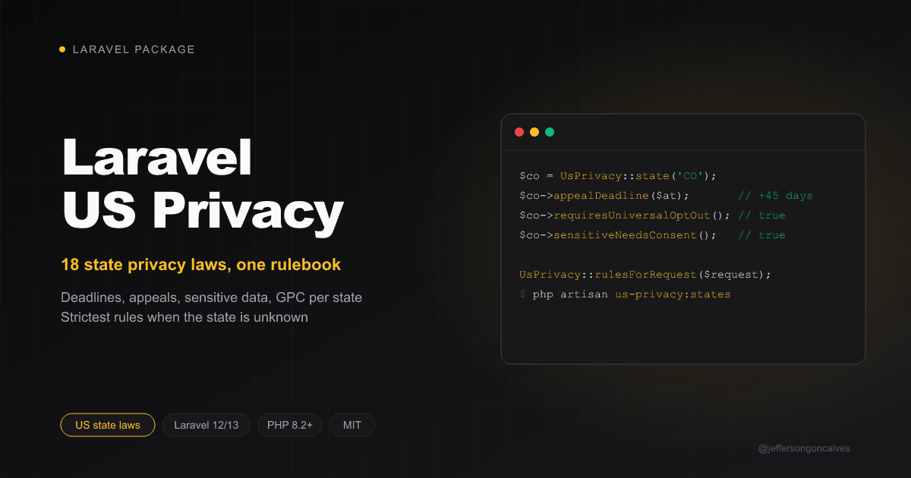

# Laravel US Privacy



[](https://packagist.org/packages/jeffersongoncalves/laravel-us-privacy)
[](https://github.com/jeffersongoncalves/laravel-us-privacy/actions/workflows/tests.yml)
[](https://packagist.org/packages/jeffersongoncalves/laravel-us-privacy)

Core of a Laravel toolkit for the comprehensive privacy laws of the US states: Virginia, Colorado, Connecticut, Utah, Texas, Oregon, Montana, Iowa, Delaware, Nebraska, New Hampshire, New Jersey, Tennessee, Minnesota, Maryland, Indiana, Kentucky and Rhode Island. California has its own suite ([laravel-ccpa](https://github.com/jeffersongoncalves/laravel-ccpa)).

- **The rules of each state**: when it took effect, who it covers, deadlines for requests and appeals, how sensitive data may be processed, when opt-out preference signals (Global Privacy Control) must be honored, whether data protection assessments are required, the rules for minors and the rights consumers have.
- **The rules for each visitor**: the law of their state, or the strictest combination when their state is unknown.
- **The personal data inventory**: which columns hold personal data, which are sensitive, and which you sell or use for targeted advertising or profiling. Export a consumer's data (access, portability) and deidentify it (deletion).

> This package gives you tooling. It does not make you compliant on its own. The state rules below were compiled in November 2026 from the statutes and attorney general guidance; laws keep changing and the trackers disagree on some dates. Verify with counsel, and override anything in `config/us-privacy.php`.

## Installation

```bash
composer require jeffersongoncalves/laravel-us-privacy
php artisan vendor:publish --tag="us-privacy-config"
```

## The state laws

```bash
php artisan us-privacy:states
php artisan us-privacy:states --consumers=40000 --sensitive   # which laws apply to you
```

| State | Response | Appeal | Sensitive data | Universal opt-out | Assessments | Minors (sale, targeted ads) |
|---|---|---|---|---|---|---|
| Virginia (2023-01-01) | 45 + 45 | 60 | opt-in | — | yes | under 13 |
| Colorado (2023-07-01) | 45 + 45 | 45 + 60 | opt-in | 2024-07-01 | yes | under 18 |
| Connecticut (2023-07-01) | 45 + 45 | 60 | opt-in | 2025-01-01 | yes | under 18 |
| Utah (2023-12-31) | 45 + 45 | — | notice + opt-out | — | no | under 13 |
| Texas (2024-07-01) | 45 + 45 | 60 | opt-in | 2025-01-01 | yes | under 13 |
| Oregon (2024-07-01) | 45 + 45 | 45 + 45 | opt-in | 2026-01-01 | yes | under 16 |
| Montana (2024-10-01) | 45 + 45 | 60 | opt-in | 2025-01-01 | yes | under 18 |
| Iowa (2025-01-01) | 90 + 45 | 60 | notice + opt-out | — | no | under 13 |
| Delaware (2025-01-01) | 45 + 45 | 60 | opt-in | 2026-01-01 | yes | under 18 |
| Nebraska (2025-01-01) | 45 + 45 | 60 | opt-in | 2025-01-01 | yes | under 13 |
| New Hampshire (2025-01-01) | 45 + 45 | 60 | opt-in | 2025-01-01 | yes | under 16 |
| New Jersey (2025-01-15) | 45 + 45 | 60 | opt-in | 2025-07-15 | yes | under 17 |
| Tennessee (2025-07-01) | 45 + 45 | 60 | opt-in | — | yes | under 13 |
| Minnesota (2025-07-31) | 45 + 45 | 45 + 60 | opt-in | 2025-07-31 | yes | under 16 |
| Maryland (2025-10-01) | 45 + 45 | 60 | strictly necessary only | 2025-10-01 | yes | under 18, prohibited |
| Indiana (2026-01-01) | 45 + 45 | 60 | opt-in | — | yes | under 13 |
| Kentucky (2026-01-01) | 45 + 45 | 60 | opt-in | — | yes | under 13 |
| Rhode Island (2026-01-01) | 45 + 45 | 60 | opt-in | — | yes | under 13 |

Days. Every state also requires parental consent for the data of a known child under 13 (COPPA). Extra rights: Oregon, Delaware, Minnesota and Maryland let consumers ask for the list of third parties their data went to; Minnesota lets them question the result of profiling. Iowa and Utah have no right to correct.

```php
use JeffersonGoncalves\UsPrivacy\Facades\UsPrivacy;

$co = UsPrivacy::state('CO');
$co->requestDeadline($receivedAt);                 // +45 days
$co->requestDeadline($receivedAt, extended: true); // +90 days
$co->appealDeadline($appealedAt);                  // +45 days (null in Utah)
$co->sensitiveNeedsConsent();                      // true (false in Utah and Iowa)
$co->requiresUniversalOptOut();                    // true since 2024-07-01
$co->hasRight('opt_out_profiling');                // true
$co->applies(consumers: 120000);                   // true

UsPrivacy::inForce();     // laws in force today
UsPrivacy::strictest();   // shortest deadlines, opt-in, opt-out signals honored, every right
```

### The rules for a visitor

```php
$rules = UsPrivacy::rulesForRequest($request); // StateRules, or null when no US state law applies
```

The state comes from a location header holding the two-letter code, read only when the country header says `US`. With Cloudflare, turn on the *Add visitor location headers* managed transform (`cf-ipcountry`, `cf-region-code`; set other names with `state_header` and `country_header`), or bring your own:

```php
UsPrivacy::resolveStateUsing(fn (Request $request) => $request->user()?->state);
```

A visitor from another country gets `null`. A US visitor whose state is unknown gets `unknown_state`: the strictest combination of the laws in force (default), or a state code. A state without a comprehensive law (California included: use laravel-ccpa) gets `null`.

## Declaring personal data

```php
use JeffersonGoncalves\UsPrivacy\Attributes\PersonalData;
use JeffersonGoncalves\UsPrivacy\Concerns\InteractsWithPersonalData;
use JeffersonGoncalves\UsPrivacy\Contracts\HasPersonalData;
use JeffersonGoncalves\UsPrivacy\Enums\{AnonymizeStrategy, DataCategory, SensitiveType};

#[PersonalData('name', purpose: 'Account identification', anonymize: AnonymizeStrategy::Mask)]
#[PersonalData('email', retention: '5 years', anonymize: AnonymizeStrategy::Hash, targetedAdvertising: true)]
#[PersonalData('health_notes', sensitiveType: SensitiveType::Health)]
#[PersonalData('purchase_history', sold: true, profiling: true)]
class User extends Authenticatable implements HasPersonalData
{
    use InteractsWithPersonalData;
}
```

- `sensitiveType` (or `category: DataCategory::Sensitive`) marks sensitive data. The types cover the definitions of every state: racial or ethnic origin, religious beliefs, health, sex life or orientation, citizenship or immigration status, genetic and biometric data, data of a known child, precise geolocation, and those only some states list (national origin, transgender or nonbinary status, crime victim status, financial account, government identifier, union membership, neural data, consumer health data).
- `sold`, `targetedAdvertising` and `profiling` mark the processing consumers can opt out of in every state.

Register the model in `config/us-privacy.php`:

```php
'models' => [
    App\Models\User::class,
],
```

### Deidentify strategies

| Strategy | Result |
|---|---|
| `Nullify` (default) | `null` |
| `Hash` | HMAC-SHA256 keyed by `US_PRIVACY_HASH_KEY` (falls back to `APP_KEY`). It gives a stable pseudonym, so unique indexes keep working |
| `Mask` | `Mary Smith` → `M*********` |
| `Keep` | untouched, for data you must keep (an exception to deletion, such as a legal obligation) |

Encrypted casts (`'encrypted'`) work as expected: the value is decrypted, then deidentified, then encrypted again.

## Usage

```php
UsPrivacy::inventory();            // one row per declared column, with sensitive_type, sold, targeted_advertising, profiling
$user->exportPersonalData();       // ['name' => ..., 'email' => ..., ...]
$user->anonymizePersonalData();    // applies each strategy and saves
```

`anonymizePersonalData()` fires `JeffersonGoncalves\UsPrivacy\Events\PersonalDataAnonymized` with the model and the columns it changed. Columns marked `Keep` are not in that list.

```bash
php artisan us-privacy:inventory          # table
php artisan us-privacy:inventory --json   # machine readable
```

## k-anonymity

Deidentified data must not reasonably be linkable to a consumer. Before you share or publish a dataset as deidentified, check that nobody can be singled out by combining quasi-identifiers such as ZIP code, birth date and gender. A dataset is *k*-anonymous when every combination of those values is shared by at least *k* rows. It is *l*-diverse when each of those groups also holds at least *l* distinct sensitive values.

```php
use JeffersonGoncalves\UsPrivacy\Generalize;

UsPrivacy::kAnonymity(Patient::class, [
    'zip' => Generalize::prefix(3),         // 94110 → 941
    'birth_date' => Generalize::date('Y'),  // 1990-03-01 → 1990
    'age' => Generalize::range(10),         // 34 → 30-39
    'gender',                               // as stored
], k: 5, sensitive: 'diagnosis');

// ['rows' => 1200, 'groups' => 87, 'k' => 3, 'rows_below_k' => 14, 'l' => 1]
```

```bash
php artisan us-privacy:k-anonymity "App\Models\Patient" zip birth_date --k=5 --sensitive=diagnosis
```

The command fails (exit code 1) when the data is below the target *k*, so it can run in CI or before a scheduled export.

## Upgrading to 2.0

2.0 runs on [laravel-privacy](https://github.com/jeffersongoncalves/laravel-privacy), the engine shared by the
LGPD, GDPR, CCPA, US privacy and Quebec suites. The classes, config keys, tables, commands and events of this package
keep their names: your code, config and data need no change. Suites installed side by side never see each other's
events. If you extend a class of this package, it now inherits from its `JeffersonGoncalves\Privacy` base.

## Testing

```bash
composer test
```

## Changelog

See [CHANGELOG](CHANGELOG.md).

## License

The MIT License (MIT). See [License File](LICENSE.md).
